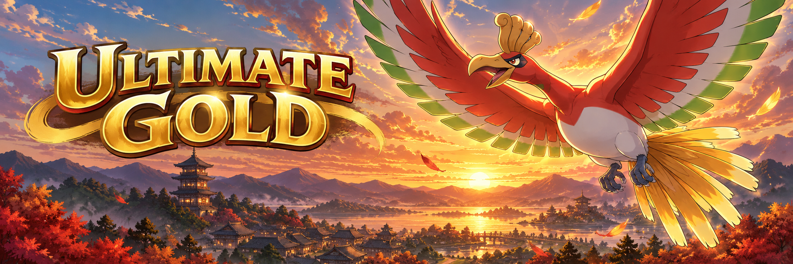

  
<strong>HEARTGOLD · JOHTO · FAN PROJECT</strong>

  <h1>ULTIMATE GOLD</h1>
  
<strong>A fresh Johto journey, shaped by selected Sacred Gold lineage.</strong>

  
A local-first browser patcher, a field guide, and three clearly labeled builds.

  

    <a href="https://0xcyberberserker.github.io/pokemon-ultimate-gold/wiki/#/patcher"><strong>Open the patcher</strong></a>
    · <a href="https://0xcyberberserker.github.io/pokemon-ultimate-gold/wiki/">Explore the wiki</a>
    · <a href="https://0xcyberberserker.github.io/pokemon-ultimate-gold/wiki/#/guide/features">Features</a>
  

  

    
    
  

> **Build status:** Alpha 1 is the legacy selectable build. Alpha 2 is experimental. Kris Sprint 2 is the experimental patcher default.

## A familiar Johto, carefully revised

- **HeartGold at its core:** the National Pokédex stays at 493 species; no new species are added.
- **Selected challenge changes:** trainer and encounter data draw on Drayano’s *Sacred Gold* work. Sacred Gold Plus 1.2.3 is a pinned source component; this project does not claim every upstream option is carried over.
- **Built to explore:** browse the project wiki alongside the patcher, with HeartGold’s 493-species roster intact.

## Choose your build

| Build | Status | What’s in it |
| --- | --- | --- |
| **Alpha 1** | Legacy | Native, reusable TM Refill. |
| **Alpha 2** | Experimental | Rocket kit, evolution-shop stock, and eight field actions for HMs you already own. |
| **Kris Sprint 2** | Experimental default | Alternative protagonist Kris and an experimental EV/IV/nature editor by reviewed lineage. |

Alpha 2 has bounded, exact-build testing; full-story coverage is still open. Kris Sprint 2 has no new editor QA; tests on earlier builds do not establish acceptance of this candidate. Wiki and cheat data are based on Alpha 2; compatibility with Kris Sprint 2 is unverified.

## Patch privately. Explore freely.

Choose a build and patch a clean dump from your own Pokémon HeartGold USA cartridge in your browser. The patcher checks the expected source; the ROM stays on your device, and **this project does not distribute game ROMs**. Then head to the wiki for the field guide and project notes.

  
Credits and project scope

  
<em>Sacred Gold / Storm Silver</em> are by Drayano. <em>Sacred Gold Plus</em> was originally created by NefariousnessNo3436; version 1.2.3 is continued by Umberto-DEV and contributors, with Fairy implementation by mikelan / Mikelan98. Ultimate Gold maintains its own patches and guides.

  
<a href="https://gbatemp.net/threads/pokemon-sacred-gold-storm-silver.327567/">Drayano’s project thread</a> · <a href="https://github.com/Umberto-DEV/sacred-gold-plus">Sacred Gold Plus source</a> · <a href="https://github.com/0xCyberBerserker/pokemon-ultimate-gold/blob/main/game/docs/project-status.md">Current build evidence</a>

  
Pokémon, HeartGold, and third-party work remain the property of their respective rights holders. Ultimate Gold is a fan project.

<strong>Made with 🖤 in Barcelona City 🇪🇸</strong>

---

## Español

  
<strong>HEARTGOLD · JOHTO · PROYECTO DE FANS</strong>

  <h1>ULTIMATE GOLD</h1>
  
<strong>Una nueva aventura por Johto, basada en aportaciones seleccionadas de Sacred Gold.</strong>

  
Un parcheador local en el navegador, una guía de campo y tres versiones claramente diferenciadas.

  

    <a href="https://0xcyberberserker.github.io/pokemon-ultimate-gold/wiki/#/patcher"><strong>Abrir el parcheador</strong></a>
    · <a href="https://0xcyberberserker.github.io/pokemon-ultimate-gold/wiki/">Explorar la wiki</a>
    · <a href="https://0xcyberberserker.github.io/pokemon-ultimate-gold/wiki/#/guide/features">Características</a>
  

  

    
    
  

> **Estado de las versiones:** Alfa 1 es la versión seleccionable anterior. Alfa 2 es experimental. Kris Sprint 2 es la opción experimental predeterminada del parcheador.

## Una Johto familiar, revisada con cuidado

- **HeartGold como base:** la Pokédex Nacional conserva sus 493 especies; no se añaden especies nuevas.
- **Cambios seleccionados al desafío:** entrenadores y encuentros incorporan trabajo de *Sacred Gold* de Drayano. Sacred Gold Plus 1.2.3 es un componente fuente fijado; no se afirma que se conserven todas sus opciones.
- **Para explorar:** consulta la wiki del proyecto junto al parcheador, con la Pokédex de 493 especies de HeartGold.

## Elige tu versión

| Versión | Estado | Contenido |
| --- | --- | --- |
| **Alfa 1** | Anterior | TM Refill reutilizable nativo. |
| **Alfa 2** | Experimental | Kit Rocket, existencias de objetos evolutivos y ocho acciones de campo para las MO que ya tienes. |
| **Kris Sprint 2** | Predeterminada experimental | Kris como protagonista alternativa y editor EV/IV/naturalezas experimental por linaje revisado. |

Alfa 2 cuenta con pruebas acotadas sobre el build exacto; la historia completa sigue pendiente. Kris Sprint 2 no cuenta con nuevas pruebas del editor; las pruebas de builds anteriores no aceptan esta candidata. Los datos de la wiki y los trucos se basan en Alfa 2; su compatibilidad con Kris Sprint 2 no está verificada.

## Parchea en privado. Explora a tu ritmo.

Elige una versión y aplica el parche en el navegador a un volcado limpio de tu propio cartucho de Pokémon HeartGold USA. El parcheador verifica la fuente esperada; la ROM permanece en tu dispositivo y **este proyecto no distribuye ROMs del juego**. Después, consulta la wiki y sus guías de campo.

  
Créditos y alcance

  
<em>Sacred Gold / Storm Silver</em> son de Drayano. <em>Sacred Gold Plus</em> fue creado originalmente por NefariousnessNo3436; la versión 1.2.3 continúa a cargo de Umberto-DEV y colaboradores, con la implementación Hada de mikelan / Mikelan98. Ultimate Gold mantiene sus propios parches y guías.

  
<a href="https://gbatemp.net/threads/pokemon-sacred-gold-storm-silver.327567/">Hilo del proyecto de Drayano</a> · <a href="https://github.com/Umberto-DEV/sacred-gold-plus">Fuente de Sacred Gold Plus</a> · <a href="https://github.com/0xCyberBerserker/pokemon-ultimate-gold/blob/main/game/docs/project-status.md">Evidencia de las versiones</a>

  
Pokémon, HeartGold y las obras de terceros pertenecen a sus respectivos titulares. Ultimate Gold es un proyecto de fans.

<strong>Made with 🖤 in Barcelona City 🇪🇸</strong>

