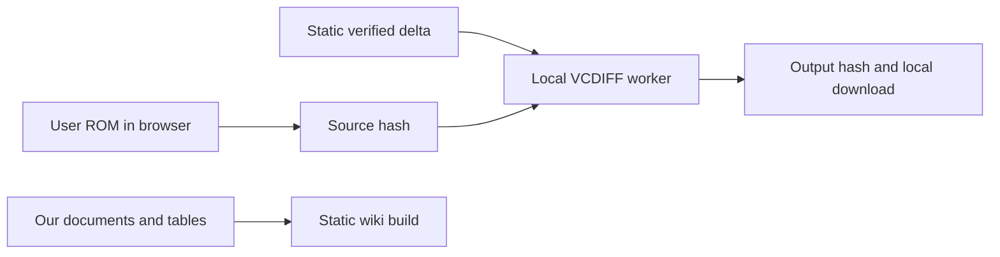
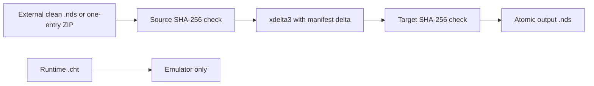

# Architecture / Arquitectura

## English

The primary route is static HTML/CSS/JavaScript plus a pinned RomPatcher.js VCDIFF worker. The browser checks clean-ROM and delta SHA-256, transfers buffers to the local worker, checks the output hash and creates a local download. Only static site assets are fetched. A standard-library Python build generates the wiki from our Markdown/CSV/JSON and validates the delta manifest. All URLs are relative for project-prefixed GitHub Pages hosting. No backend, CDN or ROM upload exists. Existing NDS/GBA patchers hosted on Pages are the model for this implementation.

The patcher uses Python standard library code and invokes an externally supplied `xdelta3` executable without a shell. A clean `.nds` is verified before patching. A ZIP is extracted only into a temporary directory and must contain exactly one `.nds`. The generated output is hash checked before an atomic rename.

The manifest pins source, target, delta, sizes, recipe, and known source properties. ROMs and runtime state are outside the trust boundary of this repository. Gameplay and controller validation are separate acceptance gates.

## Español

La ruta principal usa HTML/CSS/JavaScript estáticos y un worker VCDIFF de RomPatcher.js fijado por commit. El navegador verifica fuente y delta, procesa buffers localmente, verifica el hash de salida y crea la descarga. Sólo pide archivos estáticos de la web. Un generador de Python estándar valida el delta y convierte nuestra documentación Markdown/CSV/JSON en wiki. Las URL relativas funcionan bajo el prefijo de un proyecto Pages. No hay backend, CDN ni subida de ROM. El diseño sigue el enfoque de los patchers NDS/GBA existentes en Pages.

El patcher usa la biblioteca estándar de Python e invoca el ejecutable externo `xdelta3` sin shell. Verifica el `.nds` limpio antes de aplicar el patch. Un ZIP se extrae sólo a un directorio temporal y debe contener exactamente un `.nds`. La salida se comprueba por hash antes del renombrado atómico.

El manifiesto fija fuente, objetivo, delta, tamaños, receta y propiedades conocidas. Las ROM y el estado de runtime quedan fuera del límite de confianza del repositorio. La validación de juego y mando son gates de aceptación separados.
