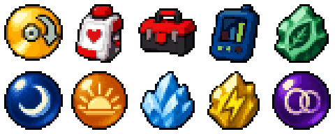

# Custom item artwork / Arte de los objetos personalizados

## English

Ultimate Gold has ten new item designs in its **private test candidate**. These graphics and its new title screen **are not in the current Alpha 2 download**. The gallery identifies their appearance; use the [Rocket kit guide](../web/wiki/#/guide/kit), [editor QA guide](../web/wiki/#/guide/stat-editor-qa) and [evolution-item guide](../web/wiki/#/guide/items) for each feature's availability and limits.

### Convenience tools

- TM Refill: gold disc with a refill arrow.
- Party Healer: white medical device with a red heart.
- Cheat Kit: black and red toolbox.
- Stat Editor: blue device displaying a stat chart.

### Evolution materials

| Materials | Visual identity |
| --- | --- |
| Woodland Ore; Chilled Ore | Green leaf mineral; blue crystal |
| Serenade Orb; Aubade Orb | Blue moon; amber sunrise |
| Voltaic Ore; Covenant Orb | Yellow lightning; violet linked rings |

### Verified in this candidate

- All ten icons appear with their names in the Bag on the exact combined build.
- The new title shows Ultimate Gold, the studio credit, the unofficial-project notice and upstream credits. A shared-palette defect was found and corrected before publication.
- One disposable synthetic inventory passed native Save and a fresh-process reload. Both save records have valid CRCs; the full Bag and three stored Pokémon match after reload. Independent review and an exact offline replay passed.

These checks cover candidate `e59680f052c450d0cc3c9e4f71da06e70ffc95be05958ed5548d4b9d6eea0d9b`, not the whole adventure, every item effect, acquisition or all emulators. The generic runner flag still says `battery_save_load: NOT_TESTED`; the separate audit verifies the observed DSV save/reload case. See the [scoped evidence summary](qa-branding-art.json).

The same ten 32 × 32 PNG files supply the ROM conversion and candidate web art. Their pinned master was generated with AI assistance; Ho-Oh and other franchise imagery are not claimed as original studio-owned art. The project wordmark reuses the approved Ultimate Gold lettering.

Developed by R'LYEH FANGAME STUDIOS. Ultimate Gold is an unofficial fan project, without affiliation or endorsement. Sacred Gold is by Drayano; Sacred Gold Plus is by Umberto-DEV and its credited contributors. Third-party rights remain with their owners. Only patches are distributed; each player supplies their own HeartGold USA dump from an original cartridge. No ROM download source is provided.

## Español

Ultimate Gold tiene diez diseños nuevos de objetos en su **candidata privada de pruebas**. Estos gráficos y su nueva portada **no están en la descarga actual de Alfa 2**. La galería muestra su aspecto; consulta la [guía del Kit Rocket](../web/wiki/#/guide/kit), el [QA del editor](../web/wiki/#/guide/stat-editor-qa) y la [guía de objetos evolutivos](../web/wiki/#/guide/items) para conocer disponibilidad y límites de cada función.

### Herramientas de comodidad

- TM Refill (Recarga MT): disco dorado con flecha de recarga.
- Party Healer (Curador del equipo): dispositivo médico blanco con un corazón rojo.
- Cheat Kit (Kit de trucos): caja de herramientas negra y roja.
- Stat Editor (Editor de estadísticas): dispositivo azul con un gráfico de estadísticas.

### Materiales evolutivos

| Materiales | Aspecto |
| --- | --- |
| Woodland Ore (Mineral Bosque); Chilled Ore (Mineral Gélido) | Mineral verde con hoja; cristal azul |
| Serenade Orb (Orbe Serenata); Aubade Orb (Orbe Alba) | Luna azul; amanecer ámbar |
| Voltaic Ore (Mineral Voltaico); Covenant Orb (Orbe Pacto) | Rayo amarillo; anillos violetas enlazados |

### Comprobado en esta candidata

- Los diez iconos aparecen con su nombre en la Bolsa de la build combinada exacta.
- La portada muestra Ultimate Gold, el crédito del estudio, el aviso no oficial y los autores upstream. Se detectó y corrigió un fallo de paleta compartida antes de publicar.
- Un inventario sintético desechable pasó guardado nativo y recarga en un proceso nuevo. Ambos registros tienen CRC válido; coinciden la Bolsa completa y los tres Pokémon guardados. Pasaron revisión independiente y reproducción offline exacta.

Estas pruebas cubren la candidata `e59680f052c450d0cc3c9e4f71da06e70ffc95be05958ed5548d4b9d6eea0d9b`, no toda la aventura, todos los efectos, la obtención ni todos los emuladores. El campo genérico del runner aún dice `battery_save_load: NOT_TESTED`; la auditoría separada verifica el caso observado de guardado/recarga DSV. Véase el [resumen de evidencia acotada](qa-branding-art.json).

Los mismos diez PNG de 32 × 32 sirven de origen para la ROM y el arte web de la candidata. El master fijado por hash se generó con asistencia de IA; Ho-Oh y otras imágenes de la franquicia no se presentan como propiedad original del estudio. Las letras del proyecto reutilizan la marca Ultimate Gold aprobada.

Desarrollado por R'LYEH FANGAME STUDIOS. Ultimate Gold es un proyecto fan no oficial y no afirma afiliación ni respaldo. Sacred Gold es de Drayano; Sacred Gold Plus, de Umberto-DEV y los colaboradores acreditados. Los terceros conservan sus derechos. Solo se distribuyen parches; cada jugador aporta su propio dump de HeartGold USA desde un cartucho original. No se indica dónde descargar ROMs.

Made with 🖤 in Barcelona City 🇪🇸
