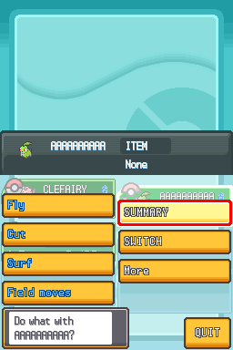
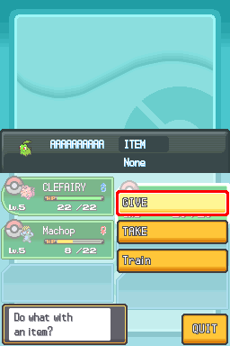
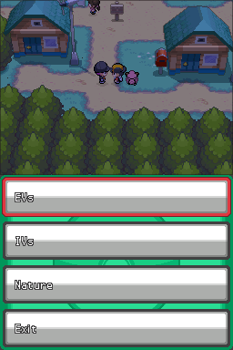

# Train a Pokémon (in development) / Entrenar a un Pokémon (en desarrollo)

## English

**Experimental.** This training menu is included in the experimental training-menu build, selected by default in the patcher. Earlier builds remain available.

EVs are training points, IVs are a Pokémon’s individual potential, and Nature changes how most stats grow. These options affect your Pokémon’s stats; review the proposal before confirming.

### Open training outside battle

- **1.** Open **Pokémon** from the main menu.
- **2.** Select a Pokémon in your party.
- **3.** Choose **More**, then **Train**.
- **4.** Choose **EVs** (Effort Values), **IVs** (Individual Values), or **Nature**. Review the proposed change before confirming it. The available editing options remain those of the existing editor.

The menu labels remain in English. **More** opens extra actions and **Train** opens the training choices.

**More** keeps the usual **Give**/**Take** actions; when the selected Pokémon holds Mail, it shows **Read**/**Take**. Choose **Quit** or press **B** to return. In one observed Egg context, the choices were **Summary**, **Switch**, and **Quit**; **Train** was absent.

This is limited candidate testing. It does not establish whole-game availability or save/reload persistence for every scenario.

### What has been checked?

- The route opens the editor with one, three or six party members. Selected first, middle and last slots were checked in separate tests.
- B cancels a preview without changing the party. Opening, returning and reopening also passed focused checks.
- One confirmed Clefairy change raised its HP IV from 15 to 20 and its displayed HP from 22 to 23. The other party members stayed unchanged, and the regular Summary screen opened.
- After closing Summary, B closes the remaining menu, X reopens it and B returns to a stable field view. A separate continuation into the party menu confirmed all three Pokémon’s data exactly matched the expected result.
- In one separate case, the edited Clefairy and its two teammates remained intact after an ordinary save and a fresh load in a new process. The checked Bag data also matched. The Continue screen itself was not captured.

These are separate checks on a development candidate, not a complete playthrough. Mail actions were displayed, but Read/Take were not exercised. Broader save/reload coverage and Nature behavior have not been established here.

## Español

**Experimental.** Este menú de entrenamiento está incluido en la versión experimental con menú de entrenamiento, seleccionada por defecto en el parcheador. Las versiones anteriores siguen disponibles.

Los EV son puntos de entrenamiento, los IV representan el potencial individual del Pokémon y la naturaleza modifica cómo crecen la mayoría de sus estadísticas. Estas opciones afectan a sus estadísticas: revisa la propuesta antes de confirmarla.

### Abre el entrenamiento fuera de combate

- **1.** Abre **Pokémon** desde el menú principal.
- **2.** Selecciona un Pokémon de tu equipo.
- **3.** Elige **More** (Más) y después **Train** (Entrenar).
- **4.** Elige **EVs** (valores de esfuerzo), **IVs** (valores individuales) o **Nature** (naturaleza). Revisa el cambio propuesto antes de confirmarlo. Las opciones de edición siguen siendo las del editor existente.

Los rótulos de la interfaz siguen en inglés: **More** abre acciones adicionales y **Train** abre las opciones de entrenamiento.

**More** conserva las acciones habituales **Give** (dar) y **Take** (retirar). Si el Pokémon lleva una carta, muestra **Read** (leer) y **Take** (retirar). Elige **Quit** (salir) o pulsa **B** para volver. En un contexto observado con un Huevo aparecieron **Summary** (resumen), **Switch** (cambiar) y **Quit**; no apareció **Train**.

Las pruebas de esta candidata son limitadas. No demuestran disponibilidad en todo el juego ni persistencia tras guardar y recargar en todos los escenarios.

### ¿Qué se ha comprobado?

- El recorrido abre el editor con equipos de uno, tres y seis Pokémon. Se comprobaron posiciones iniciales, intermedias y finales en pruebas separadas.
- B cancela una propuesta sin modificar el equipo. También se probaron la apertura, el retorno y la reapertura.
- Un cambio confirmado de Clefairy subió su IV de PS de 15 a 20 y sus PS visibles de 22 a 23. Los demás compañeros quedaron intactos y se abrió el resumen habitual.
- Tras cerrar Summary, B cierra el menú restante, X lo vuelve a abrir y B regresa a un mapa estable. Una continuación separada al menú del equipo confirmó que los datos de los tres Pokémon coincidían exactamente con el resultado esperado.
- En otro caso, Clefairy editado y sus dos compañeros se conservaron tras un guardado ordinario y una carga en un proceso nuevo. También coincidieron los datos de la Bolsa comprobados. No se capturó la pantalla de Continue.

Son comprobaciones separadas de una candidata en desarrollo, no una partida completa. Se mostraron las acciones de cartas, pero no se probaron Read/Take. Aquí no se ha acreditado una cobertura más amplia de guardado y carga ni de las naturalezas.
